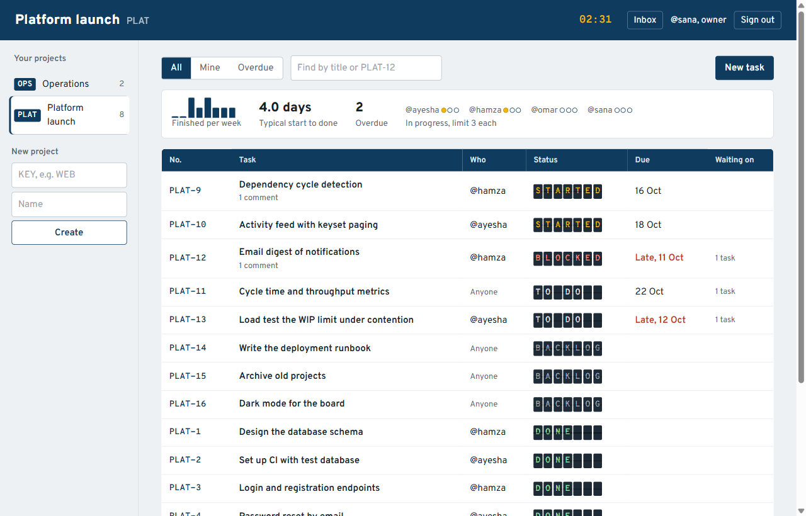
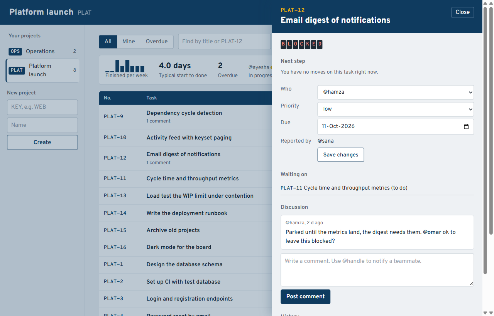

# Platform

**A project and task tracker backend with per-project roles, a review workflow, WIP limits, dependencies and flow metrics.**

[](https://github.com/qasimrazamalik-coder/platform-task-tracker-api/actions/workflows/ci.yml)


[](LICENSE)

<p align="center">
  
  
</p>

A REST API for small software teams: projects with per-project roles, tasks
that move through a review workflow, work-in-progress limits, task
dependencies, @mentions, and flow metrics computed from an activity log.
Built with Node.js, Express 5 and PostgreSQL, with a plain-JavaScript frontend
that shows the board like a station departures board.

## Highlights

- **Workflow rules in one pure function**, unit-tested and shared with the UI, so the interface never offers a move the server would reject
- **Four-eyes review**: a task can only be approved by a maintainer who is not its assignee
- **Work-in-progress limits that hold under concurrency**: the assignee's membership row is locked before counting
- **Optimistic locking** with a `version` column: stale edits get `409 VERSION_CONFLICT` and the current task
- **Dependency cycles rejected** with a recursive CTE, under a project lock so A→B and B→A can't both slip in
- **Metrics from an append-only activity log**: median cycle time (`percentile_cont`) and weekly throughput (`generate_series`)
- **Keyset pagination** and **fractional ordering** (drag-to-reorder with no renumbering)

## Run it

Needs Node.js 20 or newer. No PostgreSQL install required.

```bash
npm install
npm run db        # terminal 1: starts a real PostgreSQL on port 5542, leave it running
npm run setup     # terminal 2: creates the tables and loads demo data
npm start         # http://localhost:3002   API docs at /api/docs
```

On Windows PowerShell, if `npm` is blocked by the execution policy, use `npm.cmd`.

Demo team, all with password `password123`:

| Person | Email | Role on PLAT |
|--------|-------|--------------|
| Sana   | sana@platform.test   | owner |
| Omar   | omar@platform.test   | maintainer (can approve reviews) |
| Hamza  | hamza@platform.test  | member |
| Ayesha | ayesha@platform.test | member |
| Rehan  | rehan@platform.test  | viewer (read-only) |

Prefer Docker? `docker compose up --build`, then `docker compose exec api node scripts/seed.js`.

## Test it

```bash
npm test
```

Starts a throwaway PostgreSQL, runs 32 tests (7 pure unit tests of the
workflow rules, 25 API tests against the real database), then deletes it.

## The rules the backend enforces

**Roles are per project**, ranked owner > maintainer > member > viewer. People
who are not on a project get `404` for it, not `403`, so they can't discover
it exists.

| Who | Can |
|-----|-----|
| Viewer | Read everything on the project. Nothing else. |
| Member | Create tasks, comment, edit tasks they reported or are assigned to, move their own or unassigned tasks. |
| Maintainer | Everything on tasks, approve reviews, add members and viewers, edit the project. |
| Owner | Everything, including adding maintainers/owners and changing roles. A project always keeps at least one owner. |

**Workflow**

```
backlog -> todo -> in_progress -> in_review -> done
                     |    ^            |         |
                     v    |            v         v
                    blocked       in_progress   todo (reopen)
```

- Starting unassigned work assigns it to whoever starts it.
- A task can't start until every task it depends on is done.
- Each person can have at most `wip_limit` tasks in progress (default 3).
- Approving (in_review -> done) needs a maintainer **who is not the assignee**
  (four-eyes rule). This applies to owners too.
- Reopening a finished task needs a maintainer.

The rules live in one pure function, `src/modules/tasks/workflow.js`, with no
database or HTTP. The same function decides which buttons the UI shows
(`allowedTransitions` on the task detail), so the interface can never offer a
move the server would reject.

## How concurrency is handled

| Problem | Solution | Test |
|---------|----------|------|
| Two people edit the same task from stale screens | **Optimistic locking**: every task has a `version`; edits must send it; a stale one gets `409 VERSION_CONFLICT` with the current task | "optimistic locking" |
| Many "start work" clicks at once slip past the WIP limit | The assignee's membership row is locked (`FOR UPDATE`) before counting, so starts for one person are serialised | "RACE: six tasks started at once" |
| Concurrent creates get duplicate task numbers | Numbers come from `UPDATE projects SET next_number = next_number + 1 ... RETURNING`, which locks the counter row | "RACE: ten tasks created at once" |
| A->B and B->A added together create a cycle | The project row is locked while the cycle check (a recursive CTE) runs | "RACE: A->B and B->A" |
| Two owners demote each other and leave no owner | Owner rows are locked while counting | "a project always keeps an owner" |

Locks are always taken in the same order (task, then membership), which avoids
deadlocks. If one ever happens, the error handler returns `503 RETRY`.

## Other design points worth discussing

- **Activity log as the source of truth for metrics.** Every change appends an
  event. Cycle time (first move to in_progress until done, median and mean via
  `percentile_cont`) and weekly throughput (gaps filled with `generate_series`)
  are computed from it.
- **Keyset pagination** for the activity feed (`?before=<id>`), which stays
  correct while new events arrive, unlike `OFFSET`.
- **Fractional ordering** for drag-to-reorder: a moved task gets the midpoint
  between its neighbours. `NUMERIC` has arbitrary precision, so no renumbering.
- **@mentions** only notify people on the project, and never the author.
- **Removing a member** sends their open work back to the pool rather than
  leaving tasks assigned to someone who left.
- **Stable error codes** (`WIP_LIMIT`, `FOUR_EYES`, `DEPENDENCY_CYCLE`...).
  Clients branch on the code, not the message.

## Project layout

```
db/migrations/      schema: enums, tables, partial indexes, updated_at trigger
docs/openapi.yaml   API specification, served at /api/docs
public/             frontend (HTML, CSS, vanilla JS)
scripts/            dev database, migrations, seed data, test runner
src/
  app.js            Express app: security headers, routes, docs, errors
  db.js             pool, transactions, activity log and notification helpers
  middleware/       JWT auth, zod validation, error mapping
  modules/
    auth/           register, login, current user
    projects/       projects, members, activity feed, metrics; access.js holds role checks
    tasks/          workflow.js (pure rules), service.js (locking + SQL), routes.js
    comments/       comments and @mentions
    notifications/  inbox and mark-as-read
tests/              workflow unit tests, project and task API tests
```

## Contributing

Issues and pull requests are welcome. Every push and pull request runs the full test suite against PostgreSQL 16 on Node 20 and 22, checks runtime dependencies with `npm audit`, and builds the Docker image. `main` is protected: changes go through a pull request with a green build.

## Security

Please report vulnerabilities privately; see [SECURITY.md](SECURITY.md). The demo accounts and development secrets are for local use only.

## License

[MIT](LICENSE) © 2026 Qasim Raza Malik
